# eWasteMart — Academic Feature Implementation Plan

> **Branch:** `24-adding-features-of-gen-ai-soft-computing-computer-vision`  
> **Stack:** Next.js 16, MongoDB/Mongoose, Tailwind CSS, OpenRouter AI  
> **Goal:** Add three academically demonstrable feature groups, one per subject.

---

## Project Summary (Existing)

| Layer | Details |
|---|---|
| **Framework** | Next.js 16 (App Router) |
| **Database** | MongoDB via Mongoose |
| **Auth** | NextAuth v4 (credentials + Google OAuth) |
| **Payments** | Razorpay + Paytm |
| **AI (existing)** | OpenRouter chatbot + smart price estimate |
| **Roles** | `user`, `bulk_seller`, `recycler`, `enterprise` |
| **Core flows** | Create listing → Bid → Approve bid → Pickup → Payment |

---

## Subject 1 — Generative AI 🤖

### Feature 1A: AI-Powered Listing Description Generator
**What:** When creating a listing, the user types basic info (e.g., "10 old laptops, broken screens") and clicks **"Generate with AI"**. The AI produces a professional listing title + description optimized for recyclers.

**Academic angle:** Prompt engineering, LLM text generation, structured output parsing.

**Implementation:**
- **API:** `src/app/api/ai/generate-listing/route.js`
- **Prompt:** Few-shot prompt with 3 example e-waste listings
- **UI:** Add "✨ Generate" button in `Marketplace.js` listing creation form
- **Model:** OpenRouter (already configured — zero extra cost)

```
POST /api/ai/generate-listing
Body: { category, quantity, unit, condition, keywords }
Response: { title, description }
```

---

### Feature 1B: AI Environmental Impact Report Generator (RAG-style)
**What:** After a listing is sold/picked up, generate a personalized **"Impact Certificate"** — a paragraph report explaining how much CO2 was saved, metals recovered, toxins diverted, with comparison to real-world analogies (e.g., "equivalent to planting 12 trees").

**Academic angle:** RAG (retrieval-augmented generation) using structured DB data as context, grounding LLM output in real data.

**Implementation:**
- **API:** `src/app/api/ai/impact-report/route.js`
- **Input:** `listing.impact` object (already in DB schema: `co2SavedKg`, `metalsRecoveredKg`, `toxinsDivertedKg`)
- **UI:** New "📄 Download Impact Report" button on completed order cards in `/orders`
- **Output:** AI-generated paragraph + downloadable PDF (using browser print)

---

### Feature 1C: Conversational AI Chatbot — Enhanced with Context
**What:** Upgrade the existing chatbot (already in `ChatBox.js`) to support **multi-turn conversation** with session memory (stored client-side in state), so users can ask follow-up questions naturally.

**Academic angle:** Conversation history management, system prompt injection, stateful LLM interaction.

**Implementation:**
- **API:** `src/app/api/openai/route.js` — modify to accept `messages[]` array instead of single prompt
- **Client:** Update `ChatBox.js` to maintain `conversationHistory` state and pass full history
- **Cost:** Same OpenRouter key, no extra infra

---

## Subject 2 — Soft Computing 🧠

### Feature 2A: Fuzzy Logic Price Fairness Evaluator
**What:** When a recycler submits a bid, the system computes a **"Fairness Score" (0–100)** using fuzzy logic rules based on: bid amount vs. asking price, category metal value, condition, and quantity. Displayed as a color badge: 🟢 Fair / 🟡 Borderline / 🔴 Low-ball.

**Academic angle:** Fuzzy sets, membership functions, fuzzy inference system (Mamdani), defuzzification — classic soft computing.

**Fuzzy Variables:**
| Variable | Range | Fuzzy Sets |
|---|---|---|
| Price ratio (bid/ask) | 0–2× | {low, fair, high} |
| Condition score | 0–1 | {scrap, mixed, good} |
| Quantity | 1–1000 | {small, medium, bulk} |

**Implementation:**
- **File:** `src/lib/fuzzy/priceEvaluator.js` — Pure JS fuzzy engine (no library needed, ~80 lines)
- **API:** Called server-side inside `POST /api/listings/[id]/bid`
- **UI:** Show badge in bid card in `Marketplace.js` and bid list

---

### Feature 2B: Genetic Algorithm — Optimal Recycler Matching
**What:** When a listing receives 5+ bids, a **"Best Match" button** appears for the seller. Clicking it runs a Genetic Algorithm server-side to find the optimal bid — not just highest price, but a weighted fitness function: `price × 0.5 + recyclerRating × 0.3 + proximityScore × 0.2`.

**Academic angle:** GA components — chromosome encoding, selection, crossover, mutation, fitness function, generations.

**Implementation:**
- **File:** `src/lib/genetic/recyclerMatcher.js` — GA in pure JS (~120 lines)
  - Chromosome: array of bid indices
  - Fitness: weighted multi-objective score
  - Operators: tournament selection, single-point crossover, bit-flip mutation
- **API:** `POST /api/listings/[id]/best-match`
- **UI:** "🧬 Find Best Match" button in listing detail for sellers with 5+ bids

---

### Feature 2C: Neural Network — E-Waste Category Classifier (Client-side)
**What:** A lightweight feedforward neural network (implemented from scratch in JS) that classifies e-waste into categories based on 5 numeric features: weight, age, has_battery, has_screen, original_price. Runs entirely in the browser.

**Academic angle:** Backpropagation, activation functions (ReLU, Softmax), forward pass, trained weights embedded as JSON.

**Implementation:**
- **File:** `src/lib/nn/categoryClassifier.js` — NN inference engine in pure JS
- **File:** `src/lib/nn/weights.json` — Pre-trained weights (trained in Python, exported as JSON)
- **UI:** "🧠 Auto-classify" button in listing creation form — fills the `category` dropdown automatically

---

## Subject 3 — Computer Vision 👁️

### Feature 3A: E-Waste Device Detection from Photo
**What:** On the listing creation page, user uploads a photo of their e-waste. A **TensorFlow.js MobileNet model** (runs in browser, no backend) identifies what the device likely is (laptop, phone, TV, etc.) and pre-fills the `category` and `condition` estimate.

**Academic angle:** CNN, transfer learning, MobileNet architecture, object classification, client-side ML inference.

**Implementation:**
- **Package:** `@tensorflow/tfjs` + `@tensorflow-models/mobilenet` (add to package.json)
- **File:** `src/lib/cv/deviceDetector.js` — TF.js wrapper
- **UI:** Image upload in listing form → "🔍 Detect Device" button → auto-fill category
- **Labels mapping:** `src/lib/cv/labelMapping.js` — maps ImageNet labels to e-waste categories

```
ImageNet "laptop" → category: "Laptops & Computers"
ImageNet "television" → category: "TVs & Displays"  
ImageNet "cellular phone" → category: "Phones & Tablets"
```

---

### Feature 3B: Image Quality Validator
**What:** Before a listing image is uploaded to S3, run a client-side **image quality check** using TF.js — detecting if the image is blurry (Laplacian variance), too dark, or doesn't contain recognizable electronics. Show a quality badge: ✅ Clear / ⚠️ Blurry / ❌ No device detected.

**Academic angle:** Image preprocessing, convolution kernels, variance-based sharpness detection, pixel-level analysis.

**Implementation:**
- **File:** `src/lib/cv/imageQuality.js` — Canvas API + Laplacian kernel convolution
- **UI:** Integrated into the image upload step in listing creation
- **No extra packages** — uses canvas and existing TF.js from Feature 3A

---

### Feature 3C: Visual Condition Estimator (Color & Texture Analysis)
**What:** After device detection, analyze the uploaded image to estimate **physical condition** — using HSV color histogram analysis to detect burn marks (dark regions), rust (orange-brown hues), and cracks (edge detection via Sobel filter). Output: suggested condition tag.

**Academic angle:** Color spaces (RGB→HSV), histogram analysis, Sobel edge detection, image segmentation basics.

**Implementation:**
- **File:** `src/lib/cv/conditionEstimator.js` — Canvas + pixel-level analysis (~100 lines)
- **Input:** ImageData from uploaded photo
- **Output:** `{ condition: "scrap"|"repairable"|"working", confidence: 0–1, reasons: [] }`
- **UI:** Auto-suggests `condition` dropdown value with a confidence percentage

---

## Implementation Order (Phased)

```mermaid
gantt
    title eWasteMart Feature Rollout
    dateFormat  D
    section Generative AI
    1A Listing Generator     :a1, 1, 2d
    1B Impact Report         :a2, after a1, 1d
    1C Chatbot Memory        :a3, after a2, 1d
    section Soft Computing
    2A Fuzzy Logic           :b1, after a3, 2d
    2B Genetic Algorithm     :b2, after b1, 2d
    2C Neural Network        :b3, after b2, 1d
    section Computer Vision
    3A Device Detection      :c1, after b3, 2d
    3B Image Quality         :c2, after c1, 1d
    3C Condition Estimator   :c3, after c2, 1d
```



### Phase 1 — Generative AI (Days 1–4)
Priority: Easiest to implement, leverages existing OpenRouter setup.
1. `1A` Listing Description Generator
2. `1C` Multi-turn Chatbot (quick upgrade to existing)
3. `1B` Impact Report Generator

### Phase 2 — Soft Computing (Days 5–9)
Priority: Pure JS algorithms, no extra dependencies.
1. `2A` Fuzzy Logic Evaluator (most "textbook" — professors love this)
2. `2B` Genetic Algorithm Matcher
3. `2C` NN Classifier (needs pre-trained weights)

### Phase 3 — Computer Vision (Days 10–13)
Priority: Requires TensorFlow.js install + model loading.
1. `3A` Device Detection (MobileNet)
2. `3B` Image Quality Validator
3. `3C` Condition Estimator

---

## New Files to Create

```
src/
├── app/api/
│   ├── ai/
│   │   ├── generate-listing/route.js     ← 1A
│   │   └── impact-report/route.js        ← 1B
│   └── listings/[id]/
│       └── best-match/route.js           ← 2B
├── lib/
│   ├── fuzzy/
│   │   └── priceEvaluator.js             ← 2A
│   ├── genetic/
│   │   └── recyclerMatcher.js            ← 2B
│   ├── nn/
│   │   ├── categoryClassifier.js         ← 2C
│   │   └── weights.json                  ← 2C
│   └── cv/
│       ├── deviceDetector.js             ← 3A
│       ├── labelMapping.js               ← 3A
│       ├── imageQuality.js               ← 3B
│       └── conditionEstimator.js         ← 3C
└── components/
    ├── AIListingHelper.jsx               ← 1A UI
    ├── ImpactReport.jsx                  ← 1B UI
    ├── FuzzyBadge.jsx                    ← 2A UI
    ├── BestMatchButton.jsx               ← 2B UI
    └── DeviceScanner.jsx                 ← 3A+3B+3C UI
```

## Existing Files to Modify

| File | Change |
|---|---|
| `src/app/api/openai/route.js` | Accept `messages[]` for multi-turn |
| `src/components/ChatBox.js` | Maintain conversation history state |
| `src/components/Marketplace.js` | Add AI helper, fuzzy badge, device scanner |
| `src/app/api/listings/[id]/bid/route.js` | Integrate fuzzy score computation |
| `package.json` | Add `@tensorflow/tfjs`, `@tensorflow-models/mobilenet` |

---

## New Dependencies

```json
{
  "@tensorflow/tfjs": "^4.21.0",
  "@tensorflow-models/mobilenet": "^2.1.1"
}
```

> Everything else (fuzzy logic, GA, NN) is implemented in **pure vanilla JavaScript** — no libraries needed.

---

## Academic Documentation Tips

For each subject submission, highlight these specific concepts:

### Generative AI submission:
- LLM prompt engineering (few-shot learning)
- Grounding generation in structured data (RAG pattern)
- Conversation history & stateful LLM interaction

### Soft Computing submission:
- Fuzzy inference system with Mamdani rules
- Genetic algorithm with multi-objective fitness
- Feedforward NN with backprop-trained weights

### Computer Vision submission:
- CNN-based transfer learning (MobileNet)
- Laplacian sharpness / image quality metrics
- Sobel edge detection + HSV histogram analysis
